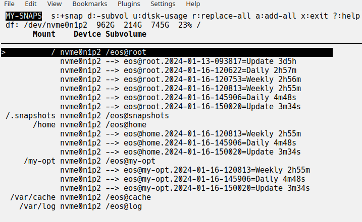
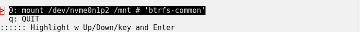
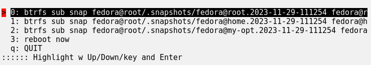

> **Minimal Quick Start:**
> * On python 3.11+, install `pipx`, else `pip`, and per your distro.
> * With `pipx`, run `pipx upgrade my-snaps || pipx install my-snaps`
> * With `pip`, run `pip install --upgrade my-snaps --user`
> * If `~/.local/bin/` is not on your $PATH, then make it so.
> * Run `my-snaps`; for each subvolume that you wish to snapshot, press `s` and append `=Update` to the suggested suffix (and create as many as you wish to keep normally).
> * Subsequently before updates, highlight one of those `=Update` snapshots and press `r` (replace-all) to add a new `=Update` snapshot to each mounted subvolume that has snapshots and drop the eldest where needed; pressing `r` elsewhere prompts for the suffix, where you can append `=Update`.
> * For regular balancing, run `bt-smart-balance -i` once to install an `anacron` job.

# my-snaps - Simple Tools for BTRFS snapshots
* `my-snaps`  assists creating snapshots and replacing the snapshots for the simplest BTRFS use cases (e.g., just before software updates).
* `my-restore` assists restoring snapshots to back out changes to the system
* `bt-smart-balance` is meant to be run regularly (say weekly) to keep your BTRFS balanced.
  Although bundled with `my-snaps`, it is unrelated to snapshots, per se.

> **Scope:** This is a highly opinionated, Linux-only, BTRFS-only tool set with best-effort support. The 2.x series is substantially hardened and more robust than 1.x, with an improved TUI experience. Issues are welcome, but see [How it compares](#how-it-compares) when deciding whether to use this or a more commonly used alternative.

**Prerequisites.** To use these tools, you must have an appropriate BTRFS setup:
* Your mounted top-level subvolume names must not contain '.' (i.e., periods).
* Your snapshot names must be one of the forms:
  * `{subvolume}.{date-string}`
  * `{subvolume}.{date-string}={label}`
* Your snapshots must reside in a top-level subvolume whose name ends with `@snapshots`; for `my-snaps` it must be mounted at `/.snapshots`.
* Any bootloader is acceptable. The [Special Behavior for BTRFS + Systemd-boot + pacman + dracut](#special-behavior-for-btrfs--systemd-boot--pacman--dracut) workaround applies only to that layout.
* Each mounted top-level subvolume is snapshotted and restored independently. Whether `/var`, `/home`, and similar directories live in the root subvolume or in their own subvolumes is a layout choice; a separate subvolume must be snapshotted and restored on its own.
* BTRFS snapshots do not include nested subvolumes; see [Choosing what to snapshot](#choosing-what-to-snapshot) for the layout implications.
* Labels define sets of snapshots that are independently managed.
  * **note**: the label (and any custom text after the timestamp) cannot contain "." or "/"
  * Suggested labels:
    * **=Update** - created prior to a system update
    * **=Daily** - scheduled daily snapshots (and similarly for other periods)

Here is a compliant BTRFS setup showing its subvolumes/snapshots:
```
top-levels: eos@cache  eos@home  eos@log  eos@my-opt  eos@root  eos@snapshots

eos@snapshots:
'eos@home.2024-01-13-093817=Update'    'eos@root.2024-01-10-174732=Update'
'eos@home.2024-01-14-085102=Daily'     'eos@root.2024-01-13-084102=Daily'
'eos@home.2024-01-15-201554=Update'    'eos@root.2024-01-13-093817=Update'
'eos@my-opt.2024-01-13-093817=Update'  'eos@root.2024-01-14-085102=Daily'
'eos@my-opt.2024-01-14-085102=Daily'
```

**Installation.**
See the Quick Start. After install, run some tests per "Initial and Regression Testing"

---

## my-snaps
`my-snaps` can be used for simple snapshot maintenance. After running, it may look like this:


<!---  -->

* In the header, the BTRFS filesystems are shown with `df -h` info (showing Size, Used, Avail, Use%, and Mounted on); run df separately to remind you of the fields when needed. A multi-device filesystem appears once, with its device shown as the first member plus `+N` (e.g., `sda1+1`).
* On your very first run, highlight each subvolume for which you wish snapshots, and press `s` to create one (the inline prompt is seeded with the current timestamp; append one of your standard labels, e.g., `=Update`).
* `r` asks for a snapshot suffix (seeded with the current timestamp) and then adds that snapshot to every mounted top-level subvolume that already has snapshots. The label in the suffix picks the family: the eldest snapshot of that label is removed where the family would grow past the largest same-label family already present, so equal-sized families keep their size instead of being trimmed.
* `a` does the same but keeps at most 8 snapshots of that label per subvolume (the eldest are removed as each new one is added).
  * the 8 is the default cap, not a hard limit: run `my-snaps -k{N}` to keep `{N}` per label in the TUI, and `-s{N}` when you want the same cap applied non-interactively.
* to describe snapshots, add a short label when prompted (e.g., `=Update` after the seeded timestamp).
* When the cursor is on a labeled snapshot (e.g., `--> deb@root.2026-10-23-073714=Daily`), `r` and `a` stay with that label: they ask `Replace a =Daily snap for 3 subvols?` or `Add a =Daily snap for 3 subvols?` and need only `y` or ESC.
  * Only mounted top-level subvolumes are counted and changed, the same set the cron job maintains, so stale snapshots from an unmounted install (e.g., `/kub@home` with its 38-week-old `=Daily`) are left alone; highlighting such a stale snapshot refuses the action.
* `d`: to remove highlighted subvolume (usually pick a snapshot); you cannot remove mounted subvolumes; if there are nested subvolumes, those are removed too.
* `u`: to gather disk usage (asks first; this can take quite a while and is not perfect)
* `f`: to freshen device and mount discovery (e.g., after plugging in a disk); the listing also refreshes automatically after a minute idle
* `?`: to get help on all keys and navigation

**NOTE**: actions often require confirmation to ensure accidental keystrokes do not clobber your system. The listing itself is read-only; only snapshot or delete actions mount a filesystem writable.

**Non-interactive use**: `my-snaps` can be run non-interactively with these options:
* `-p` or `--print` dumps your top-level subvolumes and their snapshots
* `-s{N}` or `--add-snap-max={N}` adds one new snapshot for each mounted top-level subvolume that has snapshots, using the selected label, and removes the eldest of that label until the count is at most `{N}` (`1 <= N <= 1000`). It never creates extra snapshots to fill up to `{N}` when fewer already exist.
  * out-of-range values are refused instead of clamped: a clamp would delete snapshots you asked to keep. Values above 8 print a note because they exceed the tool's default retention.
* `-L{label}` or `--label={label}` sets the label used by `-s` (and defaulted by `--cron`). Without it, `-s` manages the **unlabeled** snapshots (those without a `=label` suffix), so their old ones are replaced instead of accumulating.
* `-k{N}` or `--keep={N}` sets the number of snapshots `a` retains per label in the TUI (default 8; `1 <= N <= 1000`).
* `--cron={period}` adds an `anacron` job to add snapshots at the given period with appropriate defaulted `-s` and `-L`, or you can specify those. The defaults are `=Hourly`/2, `=Daily`/2, `=Weekly`/2, and `=Monthly`/1 for label/keep count. Notes:
  * `anacron` (or the distro's runner for `/etc/cron.*`) must be installed; it is usually bundled in a `cron` package such as `cronie`.
  * jobs are stored in `/etc/cron.{period}/{period}-snaps`, and the matching `/etc/cron.{period}` directory must exist. To change job settings, edit that file or reinstall with new options.
  * each time the job is run, its output goes to `/tmp/.my-snaps-{period}.txt`
  * removal of the `anacron` jobs is done manually

---

## my-restore
`my-restore` is used to restore one or more of your snapshots. When launched, you see something like this:


<!---  --->

Choose the desired BTRFS filesystem to mount on `/mnt` (it is unmounted first if occupied).

Next you'll see a screen like this:


<!---  --->

* Highlight and press enter on the desired choice to effect the given action:
  * **restore**: promotes the snapshot to current
  * **revert**: moves the reversion back to current
  * **del**: deletes the reversion; **note**: delay deletion until a restore passes muster.
  * **del ...ToDel**: deletes a subvolume left behind by a revert of a mounted subvolume; these are offered but never removed unless you pick them.
* when done with restores, reboot the system.
* to verify what would be done when choosing an action, you can put the tool in "dry-run" mode (`my-restore -n`). Dry-run only prints the commands: it never changes mounts and never deletes subvolumes. Because it does not mount either, `/mnt` must already hold the filesystem you want to inspect (mount it first, or start the tool while it is mounted); otherwise the action list refuses to run. It also runs unprivileged (no automatic sudo); prefix it with `sudo` when merely reading the BTRFS state requires root.
* listing the state is always read-only, so simply launching `my-restore` (with or without `-n`) cannot delete anything.

**Theory**: To restore a snapshot of the subvolume called "{subv}":
* normally, {subv} is renamed "{subv}.YYYY-MM-DD-HHMMSS=Reverted"; if a reverted tip already exists, {subv} is renamed "{subv}.YYYY-MM-DD-HHMMSSToDel" when it is mounted (so it is offered later as an explicit `del ...ToDel` choice) or deleted when it is not mounted, and
* secondly, a new, writable {subv} is created from the chosen read-only snapshot.


**------------- IMPORTANT NOTES -------------**

**When a restore is tested and deemed satisfactory then clean up.**
* To clean up, launch `my-snaps` or `my-restore` and delete "=Reverted" subvolumes (and any "del ...ToDel" entries `my-restore` offers).
* Deletion is always an explicit menu choice: `my-restore` does not sweep up leftovers on startup.
* **Warning**: Failing to clean up will confuse the next `my-restore` and waste space.

**When a restore is tested and deemed unsatisfactory:**
* Launch `my-restore` and adjust the restored snapshots as desired (e.g., restore a different snapshot or revert the reverted tip).
* Then reboot, test, and iterate until you are done and then clean up.

**In the case that an update or restore will not boot, then**:
* boot the live installer.
* install these tools per the instructions.
* use `my-restore` to return to a working system and reboot and eventually clean up the reverted subvolumes on the installed system.

---

## Initial and Regression Testing
Do not assume the BTRFS scripts work for you and then be in a pickle later. After install:
* Run `my-snaps` and ensure:
  * all the top-level subvolumes are showing, and
  * the expected snapshots are showing, and
  * add snapshots for the volumes you may wish to restore.

* If `my-snaps` is working, run `my-restore` and, after device selection, ensure the "restore" entries look right, and
* If all looks well, restore and then revert one of your subvolumes (returning all subvolumes as they were).

If there are issues, ensure snapshots are in a subvolume whose name ends with `@snapshots`, which must be mounted at `/.snapshots` for `my-snaps`, and snapshots are named `{subvol}.{timespec}[=Label]` where `{timespec}` has only numbers, dashes and colons.

If you installed periodic snap scripts:
* test with `sudo run-parts --debug -v /etc/cron.daily` (or whichever directory)
* run `ls -ltr /tmp/.my-snaps-*` to check that it was run recently by looking at timestamps.

For development, install the dev extras and run the same lint/test checks as CI from the repository root:
```
python -m pip install ".[dev]"
python -m ruff check .
python -m pylint my_snaps
python -m pytest
```

---

## Best Practices for Using this Simple Snapshot Strategy
* `my-snaps` and `my-restore` support the most simple BTRFS snapshot strategy (for update protection and limited file recovery).  To guard against huge catastrophes, add complementary strategies such as these so you can quickly reinstall if needed:
  * keep your important documents in the cloud (e.g., Google Drive)
  * keep critical configuration on github (e.g., using [How to Store Dotfiles - A Bare Git Repository | Atlassian Git Tutorial](https://www.atlassian.com/git/tutorials/dotfiles) or a dotfile manager).
  * create a list or script of post-install tasks to add/remove apps (save with your dotfiles or in the cloud)
* BTW, the above complementary strategies have even more value if you have multiple installs (e.g., a desktop, a 24/7 server, and a few laptops all running similarly with the same apps and basic config).
* For more comprehensive protection, consider `snapper`, `btrbk`, `btrfsmaintenance`, and google for others.

### Choosing what to snapshot

The layout decides what a restore rewinds, because `my-snaps` targets mounted top-level subvolumes:

* Snapshot subvolumes whose state should roll back with the system: normally the root subvolume, plus `/var` when it is separate and holds package or service state (on Debian, `/var/lib/dpkg` and `/var/lib/apt`).
* In the Fedora Silverblue/CoreOS model, `/var` is a separate subvolume that survives OS deployments, so it is outside the rollback boundary. That makes it "not rolled back," not disposable: `/var/lib/rpm`, `/var/lib/dnf`, `/var/lib/systemd`, and service state still matter.
* Snapshot `/home`, VM images, container storage, and similar large state separately, or not at all, depending on whether a root restore should rewind them.
* `/var/cache`, `/var/tmp`, and old logs are the genuinely disposable parts.
* Keep separately mounted subvolumes at the top level; a nested subvolume is not included in its parent's snapshot and moves when the parent is renamed.

---

## Special Behavior for BTRFS + Systemd-boot + pacman + dracut
In the circumstance described above, BTRFS snapshots of root will not boot. Something like:
> Booting a live installer, mounting the BTRFS subvols
> and /efi, and running `reinstall-kernels` is needed
> (plus some /efi cleanup).

To get around that, first setup a pacman hook to copy /efi to /.efi-back when the kernel is updated:
```
# place in /etc/pacman.d/hooks/95-efibackup_post.hook
[Trigger]
Operation = Upgrade
Operation = Install
Operation = Remove
Type = Path
Target = usr/lib/modules/*/vmlinuz

[Action]
Depends = rsync
Description = Backing up post /efi...
When = PostTransaction
Exec = /usr/bin/bash -c 'rsync -a -H --del /efi/ /.efi-back/'
```
Then, when replacing the root subvolume, /efi is mirrored from its `.efi-back`
if that directory exists:
```
rsync -a -H --delete "<snapshot>/.efi-back/" "/efi/"
```
The mirror is authoritative: entries that are not in the backup are removed
from /efi, so the restored root's kernels and boot entries are exactly what the
ESP advertises. It only runs when all of these hold:
* the subvolume being restored is the root subvolume, and its snapshot contains a non-empty `.efi-back`;
* `/efi` is a mount point on the running (or live) system, and it is the ESP rather than another BTRFS subvolume.

Otherwise the mirror is skipped, so an incomplete snapshot or a `/efi` that is not the ESP cannot empty the wrong tree. Systems whose ESP is mounted elsewhere (e.g., `/boot/efi` on Debian/GRUB) do not use this workaround.

-- 

## bt-smart-balance
```
bt-smart-balance [-h] [--version] [-a ALLOCATED_PCT_MIN] [-d DUSAGE]
                 [-w WASTED_PCT_MIN] [-m MOUNT_POINT] [-i]

options:
  -h, --help            show this help message and exit
  --version             show program's version number and exit
  -a, --allocated-pct-min ALLOCATED_PCT_MIN
                        min allocated percent to balance [0<=val<=99, dflt=70]
  -d, --dusage DUSAGE   btrfs -dusage filter (less is more aggressive)
                        [1<=val<=99, dflt=20]
  -w, --wasted-pct-min WASTED_PCT_MIN
                        min wasted percent to balance [0<=val<=99,dflt=7]
  -m, --mount-point MOUNT_POINT
                        BTRFS mount point [dflt=/]
  -i, --install-anacron-job
                        creates a script in /etc/cron.weekly with current args

```
`bt-smart-balance` starts a BTRFS balance if the wasted% or allocated% is at or
above the given thresholds. It can be run manually, but suggested use is to
manually run it only once with the `-i` option to install it as a weekly
`anacron` job. To change balance criteria, re-run with new options.

To decide to balance, it runs `btrfs filesystem usage <mount-point>` (prefixed
with `sudo` unless already root) and calculates
* ALLOCATED_PCT as allocated/size*100
* WASTED_PCT as (allocated-used)/size*100

The defaults are `-a 70`, `-d 20`, `-w 7`, and `-m /`. When a balance is needed
it starts a background, bounded balance:
`btrfs balance start --bg -dusage={N} <mount-point>`. It does not start a
second balance when one is already running.

---

## How it compares (as of 2026-10-24)

| Tool | Snapshot model | Strengths | Cost / gap | Fit for this use case |
|---|---|---|---|---|
| **my-snaps** | label + replace-eldest, TUI, rename-based restore | Tiny, no daemon, transparent names, tailored `.efi-back` workaround, regression suite | Packaging/docs still unfinished, one maintainer | **Keep personal** |
| **snapper** (+ snap-pac, grub-btrfs) | timeline, config retention, rollback | Mature, distro integration, boot-menu rollback (~1.2k stars) | Config/DBus/units, more moving parts | Best if you want point-and-click rollback |
| **btrbk** | snapshot + send/receive + retention | Proven offsite backups, flexible retention (~2.2k stars) | Config-heavy, no TUI restore | Use for backups, not daily updates |
| **btrfsmaintenance** | balance/scrub/trim jobs | Maintained, correct, systemd/cron integration (~1.1k stars) | Not a snapshot tool | Complement `bt-smart-balance` |
| **Timeshift** | scheduled snapshots, GUI restore | Easy GUI, popular (~4.3k stars on the Mint fork) | Heavy, less CLI-friendly, less active | Use if you want a GUI |
| **snap-pac** | pacman pre/post hooks | Automatic pre-update snapshots (~231 stars) | Arch-only, needs snapper | Complements my-snaps |
| **yabsnap** | config-driven Arch snapshots | Simple, pacman hooks, close in spirit (~113 stars) | Config file, less interactive | Closest philosophical peer |
| **grub-btrfs** | boot-menu snapshot entries | Rollback from the bootloader (~1.2k stars) | Requires snapper/snapshots | Add only if you want boot rollback |
| **btrfs-assistant** | GUI for snapper/btrbk | Convenient install/rollback | Heavier GUI stack | Not needed for this workflow |

The closest peers are **yabsnap** and **snap-pac**, not snapper or btrbk. `my-snaps`’ niche is “pre-update snapshot plus conservative manual restore.” It is not, and should not try to be, a retention-policy engine or a backup tool.

---

## Discriminating features

1. **Clear mental model.** Labels (`=Update`, `=Daily`) plus “replace the eldest of the same label” describe the pre-update use case more directly than snapper’s timeline terminology. The naming is transparent and greppable.
2. **Small maintenance surface.** No daemon, no DBus, no systemd unit, no database, and one runtime dependency. The whole tool set can be read in an evening.
3. **Simple, reversible restore theory.** Rename the current subvolume to `=Reverted`, create a writable subvolume from the read-only snapshot, and reboot. This is easier to reason about than a bootloader-integrated rollback.
4. **The `.efi-back` workaround is a real differentiator** for systemd-boot + pacman + dracut setups, documented under [Special Behavior for BTRFS + Systemd-boot + pacman + dracut](#special-behavior-for-btrfs--systemd-boot--pacman--dracut). Snapper, Timeshift, and btrbk do not solve that out of the box.
5. **Two useful interaction modes.** A curses TUI for “before an update” and `-p`/`-s`/`--cron` for automation, with no config file.
6. **The regression suite is real.** Tests run without a BTRFS filesystem, a mount, or root by substituting fake `btrfs`/`lsblk`/`rsync` executables, which keeps fixes cheap.
